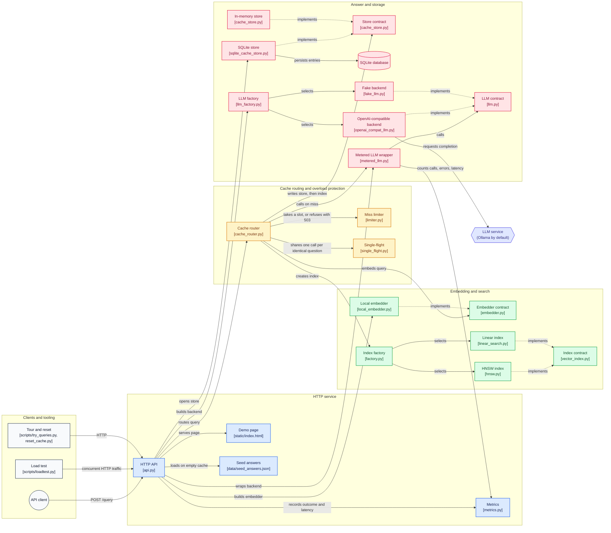
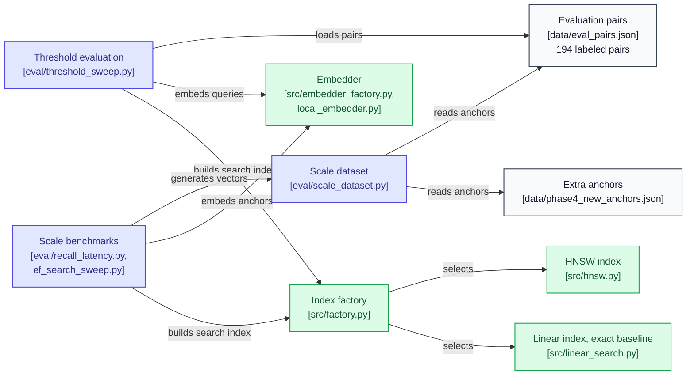

# Semantic Cache for LLM APIs

A service that caches LLM responses by meaning. When a new question is semantically equivalent
to one already answered, it returns the stored answer instead of calling the model.

```
MISS  sim=0.1657  "What's the weather in Chapel Hill?"                    model called
HIT   sim=0.9404  "Is it possible to combine my two separate accounts?"  no model call
MISS  sim=0.7266  "Can I delete one of my two accounts?"                  no match: same topic, different question
```

Output of `make tour`. The third query is close in topic to a cached entry but asks a different
question. It scores 0.7266, below the 0.80 threshold, so it goes to the model.

The repository has three parts:

| Part | Content | Where |
|---|---|---|
| **Infrastructure layer** | Thread safety, metrics, single-flight, load shedding. Each problem was reproduced under concurrent load, fixed, and measured. | [Infrastructure layer](#infrastructure-layer), [`knowledge/concurrency.md`](knowledge/concurrency.md) |
| **Vector index** | HNSW implemented without a vector library, benchmarked against exact brute-force search | [Retrieval and evaluation](#retrieval-and-evaluation), `src/hnsw.py` |
| **Evaluation** | 194 labeled pairs used to choose the similarity threshold | [Retrieval and evaluation](#retrieval-and-evaluation), `eval/` |

Infrastructure results, in brief: 20 identical concurrent requests went from 20 model calls to 1,
and a cached lookup during a burst of slow requests went from 3.1 s to 0.11 s.

## Contents

- [Quickstart](#quickstart)
- [Problem](#problem)
- [Architecture](#architecture)
- [Infrastructure layer](#infrastructure-layer)
- [Retrieval and evaluation](#retrieval-and-evaluation)
- [API](#api) and [Configuration](#configuration)
- [Repository layout](#repository-layout) and [Documentation](#documentation)

## Quickstart

Requires Python 3.9 or newer and `make`. The first run downloads the embedding model
(`all-mpnet-base-v2`, about 400 MB).

```bash
make setup                          # creates .venv, installs dependencies
ollama pull qwen2.5:7b-instruct     # model that answers new questions; skip with make run-fake
make run                            # serves http://127.0.0.1:8000
```

Open http://127.0.0.1:8000 for the demo page or http://127.0.0.1:8000/docs for the API.

On first start the service loads 67 curated question and answer pairs into `data/cache.db`.
`make run-fake` starts the service with a fake model: cached questions behave normally and new
questions get a placeholder answer.

With the service running, in a second terminal:

| Command | Result |
|---|---|
| `make tour` | Labeled queries showing which hit, which miss, and the similarity of each |
| `make loadtest` | The concurrency scenarios from the infrastructure results. Starts its own server on port 8765. |
| `make reset` | Restores the cache to the 67 curated entries |
| `make test` | 154 tests. No service and no Ollama required. |

Direct requests:

```bash
# cached question: hit, no model call
curl -s -X POST localhost:8000/query -H 'Content-Type: application/json' \
  -d '{"query": "Is it possible to combine my two separate accounts?"}'

# new question: miss, the model answers, the answer is stored. The same question then hits.
curl -s -X POST localhost:8000/query -H 'Content-Type: application/json' \
  -d '{"query": "What is the capital of France?"}'

curl -s localhost:8000/metrics
```

## Problem

Applications that call an LLM API pay latency and cost on every request, and many requests
repeat in meaning with different wording. An exact-match cache only matches identical strings.

A semantic cache matches by embedding similarity, which requires a threshold. Below the
threshold, valid matches are missed and the cache saves little. Above it, a question that only
resembles a cached one receives the cached answer, and no error is raised. The two errors have
different costs: a missed hit costs one extra model call, and a wrong hit returns an incorrect
answer. The threshold therefore has to be measured on labeled data.

A second problem appears when the service handles concurrent requests. Handlers share one
router and one index, identical requests each call the model, and slow model calls occupy the
threads that cached lookups also need. The [infrastructure layer](#infrastructure-layer) covers
this.

## Architecture

Solid arrows are calls. Dotted arrows mean "implements".



Request flow for `POST /query`:

1. `api.py` records the arrival time and passes the query to `CacheRouter`.
2. The router embeds the query (`all-mpnet-base-v2`, 768 dimensions).
3. The router searches the HNSW index for the nearest stored query, under a lock.
4. If similarity is at least 0.80, the stored answer is returned. This is a hit. It does not
   use the miss limiter, single-flight, the database or the model.
5. Otherwise the request takes a slot from the miss limiter. If none is free, the router raises
   `Overloaded` and the API returns 503 with `Retry-After`.
6. Single-flight checks whether an identical question is already waiting on the model. If so,
   this request waits and returns that answer (`coalesced: true`). If not, this request becomes
   the leader.
7. The leader searches the cache once more, because an earlier flight may have stored an answer
   since step 3. If still no match, it calls the model through `MeteredLLM`.
8. A non-empty answer is written to SQLite, then inserted into the index, then returned.
   On model failure or an empty answer, nothing is stored and the error is returned (503 or 504).

Each component behind a contract has a small factory: `VectorIndex` (linear, HNSW), `Embedder`,
`CacheStore` (in-memory, SQLite) and `LLM` (OpenAI-compatible HTTP, fake). Changing the embedder
requires re-deriving the threshold with `eval/threshold_sweep.py`, because similarity scores are
specific to an embedding model.

The OpenAI-compatible backend works with Ollama (the default), LM Studio, vLLM and OpenAI by
changing `LLM_BASE_URL`, `LLM_MODEL` and `LLM_API_KEY`.

Storage: SQLite is the source of truth. The HNSW index is rebuilt from it at startup. Cache hits
read from memory and do not query the database. The file records which embedding model built it
and refuses to open under a different one.

## Infrastructure layer

**Starting condition.** uvicorn runs one process. Plain `def` endpoints execute on a pool of 40
worker threads shared by every endpoint. The pool is not divided between hits and misses, and a
request waiting on the model holds its thread for the whole wait. All threads share one router,
one HNSW index and one set of counters.

### Results

| Scenario | Before | After | Change |
|---|---|---|---|
| 20 identical new questions at once: model calls | 20 | **1** | [Single-flight](#3-single-flight) |
| 20 different new questions at once: total time | 3.3 s | 3.3 s | Unchanged. Single-flight does not serialize them. |
| One cached question while 60 slow questions run | 3.1 s | **0.11 s** | [Load shedding](#4-load-shedding-and-timeouts) |
| The 60 slow questions | all answered, about 6 s | 24 answered, 36 refused immediately (503) | [Load shedding](#4-load-shedding-and-timeouts) |
| Forced thread switching on a new cache, 40 trials | 15 trials lost entries or raised `KeyError` | 0 | [Thread safety](#1-thread-safety) |

Measured with a fake model that waits 3 seconds. The embedder, index, SQLite and uvicorn are
real. One 10-core laptop, synthetic traffic. Reproduce with `make loadtest`.

The 0.11 s does not meet the 100 ms target. The embedder is CPU-bound: 16 ms for one embedding,
about 455 ms each when 40 run at once. Every request is embedded before it is known to be a hit,
so the miss-path cap does not help here.

### 1. Thread safety

- **Problem:** Two threads read the same id from the counter and overwrote each other's entry.
  A search that ran during an HNSW insert raised `KeyError`, because the insert updated
  `max_level` one line before `entry_point`.
- **Change:** One lock guards the id counter and every index search and insert. The embedder,
  the model call and the SQLite write run outside it.
- **Result:** 0 lost entries or exceptions in 40 trials with forced thread switching. Before: 15
  of 40.
- **Tradeoff:** Searches run one at a time (0.7 ms per search and 1.9 ms per insert at 2,000
  entries). A readers-writer lock would remove that, at a complexity cost not justified at this
  scale.
- **Files:** `cache_router.py`, `vector_index.py`

### 2. Metrics and load test

- **Problem:** The service counted hits and misses without a lock and counted nothing else.
  Handler timing cannot see a request that is waiting for a worker thread.
- **Change:** `GET /metrics` reports counters, an in-flight gauge and p50/p95/p99 latency over
  the last 2,000 samples per kind. `MeteredLLM` counts every model call. `queue_wait` is stamped
  on the event loop before the handler is queued, so it measures the wait for a worker thread.
  `make loadtest` runs the scenarios above.
- **Result:** Every number in the results table comes from this tooling. During the overload
  scenario `queue_wait` p95 was 3.4 s, in line with the 3.1 s that clients saw.
- **Tradeoff:** JSON output, not Prometheus format. Percentiles cover a recent window, not all
  time. Requests rejected by validation (422) are not counted.
- **Files:** `metrics.py`, `metered_llm.py`, `api.py`, `scripts/loadtest.py`

### 3. Single-flight

- **Problem:** 20 identical new questions made 20 model calls and wrote 20 duplicate entries.
- **Change:** A table of questions being worked on. The first request calls the model. Identical
  requests wait and share its answer (`coalesced: true`). The leader searches the cache once
  more before calling the model, in case an earlier flight stored an answer after its first
  lookup. If the model call fails, every waiting request receives the same error and nothing is
  remembered.
- **Result:** 1 model call and 1 entry for 20 identical requests. 20 different questions still
  take 3.3 s in total, because they do not wait for each other.
- **Tradeoff:** One lock around all misses would also prevent duplicates, but it would serialize
  them: 20 different 3 s questions would take 60 s and cached lookups would queue behind them.
  "Same question" means identical text after lowercasing and collapsing whitespace. Paraphrases
  that arrive together each call the model.
- **Files:** `single_flight.py`, `cache_router.py`

### 4. Load shedding and timeouts

- **Problem:** 60 slow misses occupied all 40 worker threads, and a cached lookup waited about
  3 s for a thread.
- **Change:** A cap on requests in the miss path (`MAX_CONCURRENT_MISSES`, default 24). Requests
  over the cap get 503 with `Retry-After: 1` immediately. Cache hits never use the cap. The model
  timeout is configurable (`LLM_TIMEOUT_SECONDS`, default 30). `/health` and `/metrics` are
  `async def`, so they respond when all worker threads are busy.
- **Result:** A cached lookup during the burst took 0.11 s instead of 3.1 s. 24 of the 60 slow
  requests were served and 36 refused.
- **Tradeoff:** Requests are refused instead of queued, because a queued request still holds a
  thread. Requests waiting on a shared answer count toward the cap, so 30 identical concurrent
  questions would have 6 refused even though one model call would serve all 30. The status is 503
  because the condition is server capacity, not a per-client rate limit.
- **Files:** `limiter.py`, `cache_router.py`, `api.py`

### Observability

`GET /metrics` returns JSON:

| Field | Content |
|---|---|
| `requests` | `total`, `hits`, `misses`, `coalesced`, `shed`, `errors_503`, `errors_504`, `errors_500`, `hit_rate` |
| `model` | `calls`, `errors`, `timeouts` |
| `latency_ms` | count, p50, p95, p99, max for `hit`, `miss`, `coalesced`, `shed`, `error`, `model`, `queue_wait` |
| `in_flight`, `in_flight_peak` | Handlers running now, and the maximum since start |
| `miss_path` | Slots in use and the limit |
| `entries` | Entries in the index |

### Verification

- Tests start 20 threads together with `sys.setswitchinterval(1e-6)`, which makes unfavorable
  thread interleavings likely. The thread-safety and single-flight tests fail on the unfixed
  code. The load-shedding tests were written and passed together with the code, so
  `make loadtest` is the behavioral evidence for that change.
- The service was also run against real Ollama: a miss, a hit, six identical concurrent
  questions (1 model call, 5 coalesced), and a restart with the cache intact.

### Limitations

- A cached lookup during a burst takes about 110 ms instead of 17 ms (see Results).
- Single-flight matches identical text only.
- The service must run as one process. With several workers, each process would build its own
  index and assign its own ids against the same SQLite file.
- `POST /admin/reset` replaces the router while requests may be running. A request holding the
  old router can still write to the shared store.
- Measurements use a fake model. A real model has its own concurrency limits and variable
  latency.

Full write-up: [`knowledge/concurrency.md`](knowledge/concurrency.md).

## Retrieval and evaluation

These scripts use the same embedder and index code as the service, not a copy.



### Threshold

A labeled set of 194 pairs: 67 paraphrases (should hit), 67 near-misses (same topic, different
question, should miss) and 60 unrelated. Swept with `eval/threshold_sweep.py`:

| Threshold | Hit rate | Wrong-match rate (near-misses served) |
|---|---|---|
| 0.70 | 0.55 | 0.21 |
| 0.75 | 0.40 | 0.12 |
| **0.80 (chosen)** | **0.22** | **0.07** |
| 0.85 | 0.04 | 0.04 |

0.80 was chosen over 0.85 because the cost of a wrong hit is higher than a missed hit, but at
0.85 the hit rate is 4%, which leaves the cache nearly unused. Four embedding models were
compared on this set. `all-mpnet-base-v2` scored best, ahead of `BAAI/bge-large-en-v1.5`, which
is trained with hard negatives for this kind of near-miss.

### HNSW index

`src/hnsw.py` implements HNSW without a vector library (parameters: M=16, ef_construction=200,
ef_search=50, ef_upper=8). `src/linear_search.py` is exact brute force, kept as the reference
that recall is measured against. Both implement one `VectorIndex` contract.

| n | linear query | HNSW query | HNSW recall@1 |
|---|---|---|---|
| 1,000 | 0.055 ms | 0.371 ms | 99.5% |
| 5,000 | 0.234 ms | 0.287 ms | 86.5% |
| 10,000 | 0.632 ms | 0.419 ms | 70.0% |

Brute force is faster and exact at 1,000 and still faster at 5,000. HNSW is faster at 10,000
(0.419 ms against 0.632 ms). Recall decreases as the graph grows with a fixed search width.
Two defects were found by benchmarking at larger n:

- **O(n²) insert** in the linear index (`np.vstack` reallocating on every insert): 443 s to
  0.37 s at n=50,000. Small test sets cannot distinguish O(n) from O(n²).
- **Upper-layer routing.** Recall stayed flat when `ef_search` was widened 32 times, which ruled
  out beam width and pointed to the single-path descent through the upper layers. A small beam
  (`ef_upper`) raised recall from 54% to 65.5% at n=50,000.

## API

| Endpoint | Description |
|---|---|
| `POST /query` | Body `{"query": "..."}`, 1 to 2000 characters. Returns `response`, `hit`, `coalesced`, `similarity`, `matched_id`, `latency_ms`. |
| `GET /metrics` | Counters, model calls, latency percentiles, gauges (see Observability) |
| `GET /stats` | Entries, hits, misses, hit rate. Used by the demo page. |
| `GET /health` | Liveness |
| `POST /admin/reset` | Restores the curated corpus. Requires header `X-Reset-Token`. Returns 404 unless `RESET_TOKEN` is set. |
| `GET /` | Demo page |

Status codes for `/query`: `200`, `422` for an invalid body, `503` if the model failed or
returned nothing usable, `504` if the model timed out, and `503` with `Retry-After: 1` if the
miss path is full. Nothing is stored on any error.

## Configuration

Environment variables, all optional. `MAX_CONCURRENT_MISSES`, `LLM_TIMEOUT_SECONDS` and
`SEED_ON_EMPTY` fail at startup with a message on an invalid value. `OPERATING_THRESHOLD` and
`CACHE_DB_PATH` are not range-checked.

| Variable | Default | Description |
|---|---|---|
| `CACHE_DB_PATH` | `data/cache.db` | SQLite file |
| `LLM_BACKEND` | `openai_compat` | `openai_compat` or `fake` |
| `LLM_MODEL` | `qwen2.5:7b-instruct` | Model name on the server |
| `LLM_BASE_URL` | `http://localhost:11434/v1` | Any OpenAI-compatible server |
| `LLM_API_KEY` | none | For hosted providers |
| `LLM_TIMEOUT_SECONDS` | `30` | Model call timeout (504 on expiry) |
| `MAX_CONCURRENT_MISSES` | `24` | Requests allowed in the miss path at once |
| `OPERATING_THRESHOLD` | `0.80` | Similarity threshold |
| `RESET_TOKEN` | unset | Enables `POST /admin/reset`. `make run` sets `dev-token`. |
| `SEED_ON_EMPTY` | `true` | Load the curated corpus when the cache is empty |

Run one server process. See the limitations above.

## Repository layout

| Path | Contents |
|---|---|
| `src/api.py` | HTTP entry point, settings, error mapping |
| `src/cache_router.py` | Hit/miss decision, lock, single-flight and limiter wiring |
| `src/single_flight.py`, `src/limiter.py` | Request coalescing; concurrency cap that refuses instead of waiting |
| `src/metrics.py`, `src/metered_llm.py` | Counters and percentiles; model-call counting wrapper |
| `src/hnsw.py`, `src/linear_search.py`, `src/vector_index.py`, `src/factory.py` | Indexes, contract, factory |
| `src/embedder.py`, `src/local_embedder.py`, `src/embedder_factory.py` | Embedder contract and implementation |
| `src/cache_store.py`, `src/sqlite_cache_store.py` | Store contract, in-memory and SQLite stores |
| `src/llm.py`, `src/openai_compat_llm.py`, `src/fake_llm.py`, `src/llm_factory.py` | LLM contract, backends, factory |
| `src/static/index.html` | Demo page |
| `scripts/` | `loadtest.py`, `try_queries.py`, `reset_cache.py` |
| `eval/`, `data/` | Evaluation and benchmark scripts; labeled pairs, anchors, seed answers |
| `tests/` | 154 tests. None require Ollama or network access. |

## Documentation

- [`knowledge/concurrency.md`](knowledge/concurrency.md): the infrastructure layer, with
  measurements, decisions and limitations.
- [`knowledge/learned.md`](knowledge/learned.md): 28 numbered decisions covering the index,
  threshold, evaluation and earlier design stages. It is a log written during development, so
  sections on the removed AWS deployment (Lambda, EC2, DynamoDB, Bedrock) describe code that is
  no longer in the repository. Section 25 explains the change to a local setup.
- [`knowledge/resume.md`](knowledge/resume.md): summary bullets and interview answers, with each
  number traced to a measurement.
